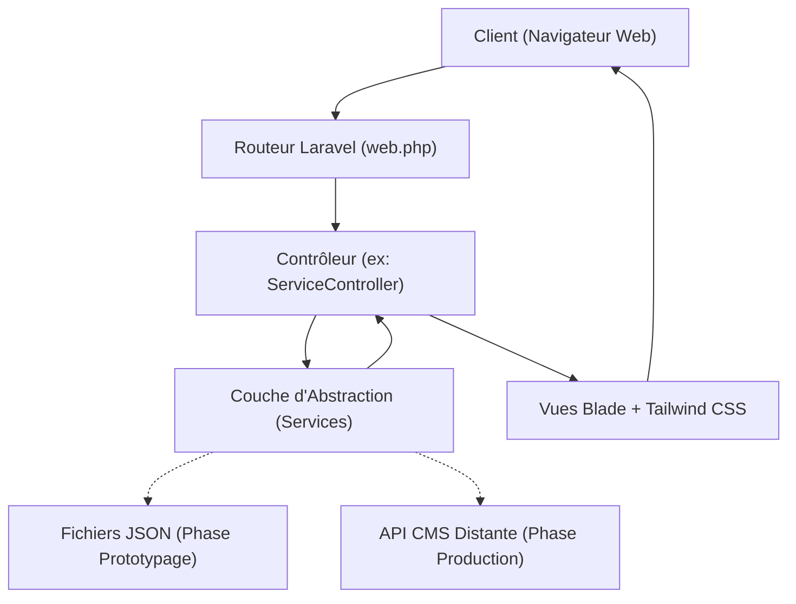

# 🚀 Enerlog Showcase & cPay Product Hub

[](https://www.enerlog-technology-digital.com/)
[](https://laravel.com)
[](https://tailwindcss.com/)
[](https://www.php.net/)
[]()
[]()
[](LICENSE)

> **Plateforme vitrine institutionnelle et commerciale d'Enerlog**, entreprise togolaise spécialisée dans les solutions numériques innovantes. Ce projet met en valeur l'écosystème de services de l'entreprise, avec un focus sur sa solution fintech phare **cPay**, grâce à une architecture modulaire, responsive et orientée conversion.
> 
> 🌐 **Site en production accessible en ligne :** [https://www.enerlog-technology-digital.com/](https://www.enerlog-technology-digital.com/)

---

## 📌 Sommaire

- [À propos du Projet](#-à-propos-du-projet)
- [Fonctionnalités Clés](#-fonctionnalités-clés)
- [Architecture & Décisions Techniques](#-architecture--décisions-techniques)
- [Étude de Cas : Le Défi WordPress Headless & Genèse du CMS](#-étude-de-cas--le-défi-wordpress-headless--genèse-du-cms)
- [Stack Technique](#-stack-technique)
- [Structure du Projet](#-structure-du-projet)
- [Installation & Démarrage Local](#-installation--démarrage-local)
- [Auteur & Contact](#-auteur--contact)

---

## 🏢 À propos du Projet

Dans le cadre de son expansion sur le marché ouest-africain, **Enerlog** avait besoin d'une vitrine digitale à fort impact pour adresser deux cibles : les **entreprises** (B2B) et les **particuliers** (B2C).

L'objectif principal était de dépasser le simple stade du site institutionnel passif pour concevoir un **véritable outil d'aide à la vente**, valorisant :
- **cPay :** La solution de paiement numérique et d'encaissement sécurisé.
- **Les services digitaux :** *Fleet Card* (gestion de carburant/flottes), *E-billet* (billetterie dématérialisée), *Cagnotte en ligne*, etc.
- **Une grille tarifaire transparente :** Forfaits comparatifs segmentés (*Basic*, *Premium*, *Pro+*).

---

## ✨ Fonctionnalités Clés

### 1. 🎯 Expérience Utilisateur & Conversion
- **Hero Section dynamique :** Proposition de valeur percutante, intégration d'accroches commerciales et boutons d'appel à l'action (CTA) stratégiques vers le téléchargement de **cPay**.
- **Page de Téléchargement Dédiée :** Landing page optimisée pour la conversion mobile (badges App Store / Google Play, tutoriel d'onboarding).
- **Refonte Visuelle Orientée Vente :** Typographie modernisée, palette chromatique corporate, icônes illustratives et design 100% **Mobile-First** (adaptabilité testée sur smartphones, tablettes et écrans larges).

### 2. 💼 Catalogue des Services & Grilles Tarifaires
- **Fiches Services Atomiques :** Présentation claire et synthétique des prestations techniques avec cas d'usage clients.
- **Matrice Tarifaire Interactive :** Tableau comparatif des plans d'abonnement (*Basic*, *Premium*, *Pro+*) facilitant la décision d'achat pour les décideurs B2B.

### 3. 📰 Newsroom & Référencement (SEO)
- **Système d'Actualités / Blog :** Diffusion des lancements de produits, partenariats stratégiques et communiqués d'Enerlog.
- **Optimisation SEO Avancée :** Intégration de la suite **SEOTools** dans les contrôleurs pour la génération automatique des balises méta, balises canoniques et cartes OpenGraph (partages optimisés sur LinkedIn, X/Twitter, WhatsApp).

### 4. 📬 Relations Clients & Partenaires
- **Formulaire de Contact Sécurisé :** Protection CSRF, validation stricte des payloads et notification automatisée par e-mail vers l'équipe commerciale.
- **Section Réassurance :** Espace partenaires institutionnels et avis clients vérifiés pour asseoir la crédibilité de la marque.

---

## 🏗️ Architecture & Décisions Techniques

Le projet a été pensé dès le premier jour selon les principes de l'**architecture en couches** pour garantir l'agilité et l'indépendance des données.



### 💡 Stratégie de Persistance Évolutive (JSON vers API)
Plutôt que de figer prématurément un schéma de base de données relationnelle avant que le marketing n'ait validé la structure des offres, nous avons adopté une **approche Contract-First** :
1. **Phase Prototypage Rapide :** Modélisation des entités (*Services*, *Tarifs*, *Actualités*) dans des fichiers JSON structurés.
2. **Couche d'Abstraction (Service Layer) :** Le contrôleur interroge un service métier (`ServiceService`, `NewsService`) sans jamais savoir où les données sont physiquement stockées.
3. **Transition Invisible :** Le basculement vers une API externe ou un CMS sur-mesure s'effectue par une simple modification du service interne, **sans impacter une seule ligne des contrôleurs ou des vues Blade**.

---

## 🔬 Étude de Cas : Le Défi WordPress Headless & Genèse du CMS

> [!NOTE]
> Cette section documente un retour d'expérience technique réel et les arbitrages architecturaux menés lors du projet.

### Le Contexte
Pour permettre à l'équipe commerciale et marketing d'éditer les contenus en autonomie, nous avons initialement prototypé un couplage **Laravel (Frontend) + WordPress Headless (Back-Office)** via l'API REST et l'extension **ACF (Advanced Custom Fields)**.

### Le Problème Rencontré (Goulot d'Étranglement API)
L'API REST native de WordPress couplée à ACF ne retournait pas de structure profondément imbriquée :
- Pour afficher une seule page de service complète (service + tarifs associés + médias + métadonnées), le client Laravel devait exécuter **3 à 4 requêtes HTTP successives (effet N+1)**.
- **Conséquence :** Temps de chargement dégradé, latence réseau élevée et impact négatif potentiel sur le SEO.

### Mesures Palliatives Mises en Œuvre
Pour préserver les performances perçues par les visiteurs, nous avons déployé :
1. **Système de Cache Agressif sous Laravel :** Mise en cache des réponses d'API avec durée de validité (TTL) et invalidation automatique.
2. **Requêtes Asynchrones / Parallèles :** Utilisation du client HTTP Laravel (Guzzle Pool) pour paralléliser les appels distants.

| ❌ Limites WordPress Headless | ✅ Décision d'un CMS Interne Dédié |
| :--- | :--- |
| • Structure API rigide et requêtes successives (N+1) | • Structure JSON optimisée en 1 seule requête |
| • Dépendance aux extensions tierces (ACF) | • Contrôle total sur la sécurité et le schéma |
| • Latence réseau résiduelle | • Composants atomiques réutilisables |

**Conclusion stratégique :** Ce constat a motivé la direction à concevoir un **CMS Modulaire interne sur-mesure** (projet complémentaire développé en Vue.js / Node.js), assurant une autonomie technologique totale et des performances optimales.

> [!TIP]
> **🔗 Dépôts associés du CMS Modulaire (Suite du projet) :**
> 
> Pour pallier définitivement les limites structurelles de WordPress et offrir une flexibilité totale aux équipes marketing, la suite logicielle a été découpée en deux projets indépendants :
> - 🖥️ **Interface d'administration (Frontend) :** [CMS_FRONT](https://github.com/chtoure/CMS_FRONT) — Application web moderne orientée composants modulaires *(Vue 3 / TypeScript / Tailwind CSS)*.
> - ⚙️ **Moteur d'API & Données (Backend) :** [CMS_BACKEND](https://github.com/chtoure/CMS_BACKEND) — API REST haute performance pour la composition dynamique des pages et des blocs *(Node.js / Express / PostgreSQL)*.

---

## 🛠️ Stack Technique

| Domaine | Technologies & Outils | Rôle |
| :--- | :--- | :--- |
| **Backend** | **PHP 8.x**, **Laravel 10** | Framework applicatif, routage, validation, architecture de services |
| **Frontend** | **Blade Templates**, **Tailwind CSS** | Templating réactif, utilitaires CSS, mise en page Mobile-First |
| **SEO & Méta** | **Artesaos / SEOTools** | OpenGraph, Twitter Cards, balises méta canoniques dynamiques |
| **Assets & Build** | **Vite / Laravel Mix** | Compilation et minification des scripts et styles |
| **Qualité / Tests** | **Pest / PHPUnit** | Tests unitaires des couches de services et d'abstraction |

---

## 📂 Structure du Projet

```text
site-vitrine-enerlog/
├── app/
│   ├── Http/
│   │   └── Controllers/
│   │       ├── HomeController.php       # Gestion Hero, partenaires & conversions
│   │       ├── ServiceController.php    # Catalogue des prestations et solutions
│   │       ├── PricingController.php    # Grilles tarifaires et forfaits
│   │       ├── NewsController.php       # Flux d'actualités et blog avec SEOTools
│   │       ├── ContactController.php    # Formulaire de contact et envoi d'emails
│   │       └── TeamController.php       # Équipe, histoire et mission Enerlog
│   └── Services/                        # Couche d'abstraction des données
│       ├── ServiceDataService.php       # Fournisseur de données (JSON / API)
│       └── NewsDataService.php          # Fournisseur des articles
├── resources/
│   ├── data/                            # Sources de données contractuelles (JSON)
│   │   ├── services.json
│   │   ├── pricing.json
│   │   └── news.json
│   ├── views/                           # Vues Blade modulaires
│   │   ├── layouts/
│   │   │   └── app.blade.php            # Layout maître (Header, Footer, Meta)
│   │   ├── pages/                       # Pages complètes (Accueil, À propos, cPay)
│   │   └── components/                  # Composants réutilisables (Cards, CTA, Modales)
│   └── css/                             # Configuration Tailwind CSS
└── routes/
    └── web.php                          # Définition des routes applicatives
```

---

## 🚀 Installation & Démarrage Local

### Prérequis
- **PHP** >= 8.1 avec extensions requises (`curl`, `mbstring`, `openssl`, `xml`)
- **Composer** (v2.x)
- **Node.js** (v18+) & **npm**

### Étapes d'installation

1. **Cloner le dépôt :**
   ```bash
   git clone https://github.com/chtoure/enerlog-site-vitrine.git
   cd enerlog-site-vitrine
   ```

2. **Installer les dépendances PHP :**
   ```bash
   composer install
   ```

3. **Installer les dépendances Frontend :**
   ```bash
   npm install
   ```

4. **Configurer l'environnement :**
   ```bash
   cp .env.example .env
   php artisan key:generate
   ```

5. **Compiler les assets (Vite / Tailwind) :**
   ```bash
   npm run build
   # ou pour le développement en direct : npm run dev
   ```

6. **Lancer le serveur de développement local :**
   ```bash
   php artisan serve
   ```
   L'application est disponible à l'adresse : `http://localhost:8000`.

---

## 🌐 Écosystème & Projets Liés

Ce projet s'inscrit dans une suite applicative complète développée pour Enerlog :

| Dépôt | Rôle | Stack Technique | Lien GitHub |
| :--- | :--- | :--- | :--- |
| **Site Vitrine Enerlog** *(ce dépôt)* | Vitrine commerciale & produit cPay | Laravel 10, Tailwind CSS, SEOTools | [🌐 Site en ligne](https://www.enerlog-technology-digital.com/) • [GitHub](https://github.com/chtoure) |
| **CMS_FRONT** | Back-office d'administration modulaire | Vue 3, TypeScript, Tailwind CSS, Pinia | [chtoure/CMS_FRONT](https://github.com/chtoure/CMS_FRONT) |
| **CMS_BACKEND** | Moteur d'API REST & Gestion de contenu | Node.js, Express, PostgreSQL, Prisma | [chtoure/CMS_BACKEND](https://github.com/chtoure/CMS_BACKEND) |

---

## 👨‍💻 Auteur

**Chabane TOURE**  
*Développeur Full-Stack | Ingénieur Logiciel*  
- **GitHub :** [@chtoure](https://github.com/chtoure)  
- **Linkedin:** [Linkedin](http://www.linkedin.com/in/chabane-toure-94a83a350)

---
*Projet réalisé dans le cadre du développement des plateformes digitales d'Enerlog — Tous droits réservés.*
